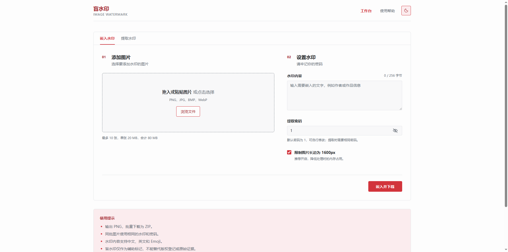
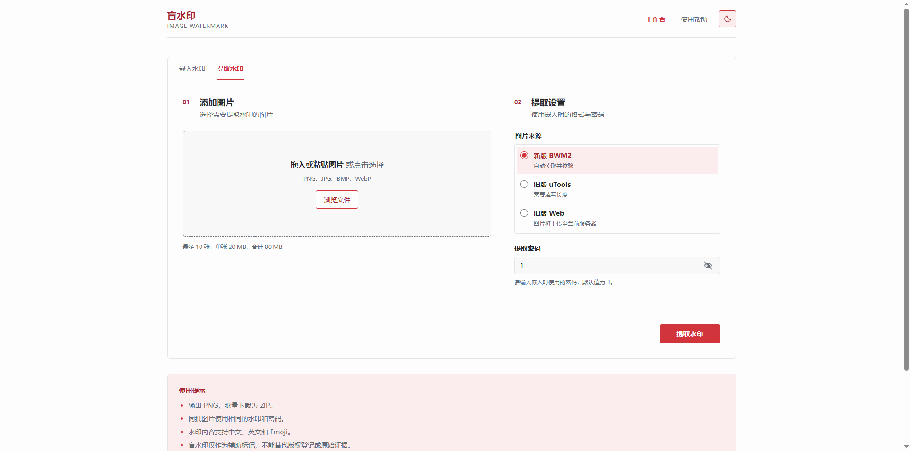
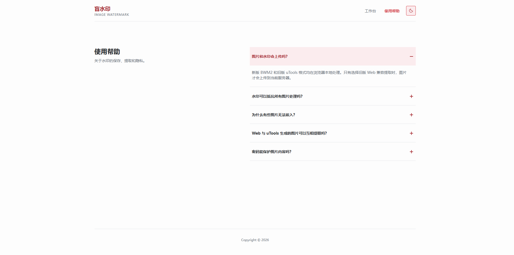
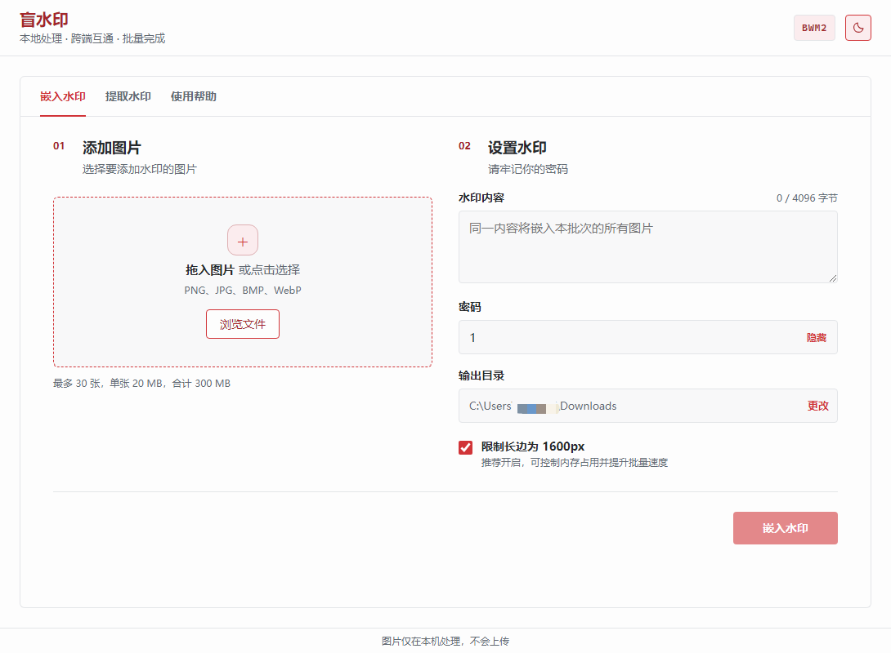
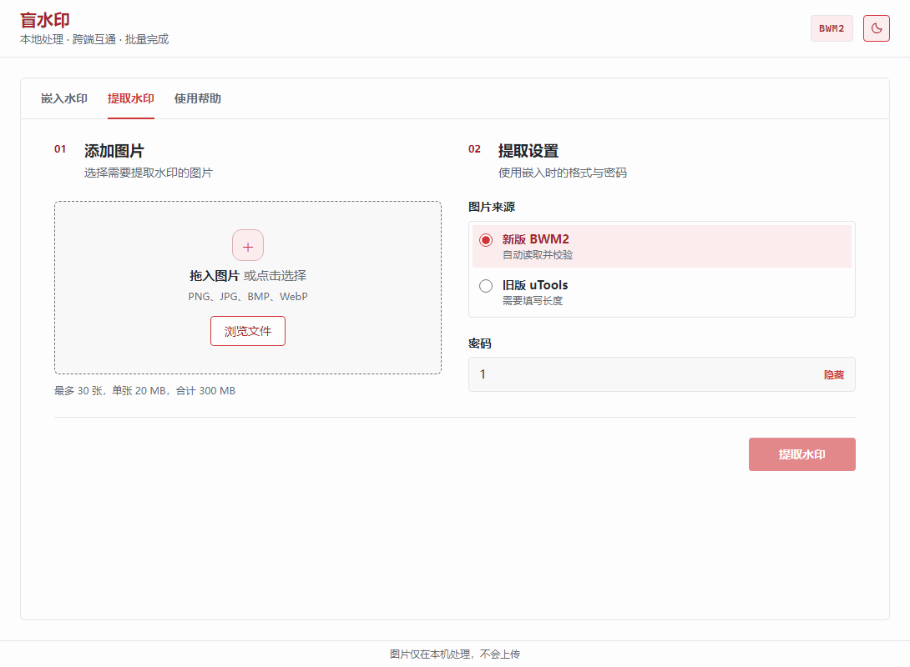
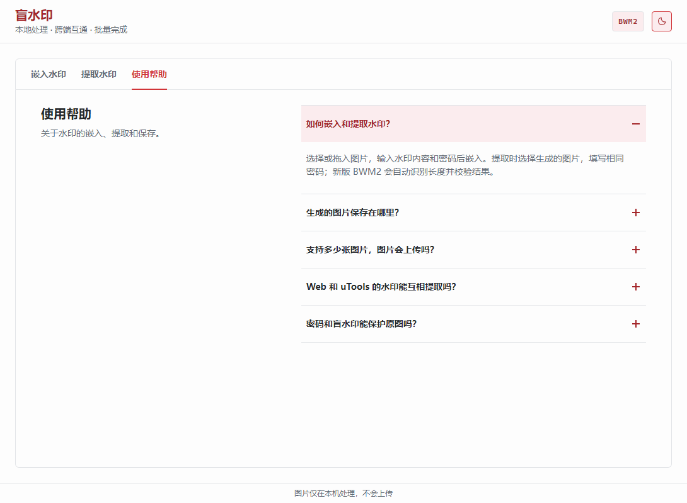

# 盲水印工具

面向日常图片标记与验证的盲水印工具，提供 Web 与 uTools 两个版本。新版统一使用 **BWM2** 格式，支持中文、Emoji、批量处理、自动识别长度和完整性校验；两端生成的新版图片可以互相提取。

## 核心能力

- 单张或批量嵌入：一组水印和密码应用到多张图片。
- 单张或批量提取：新版无需记录 bit 长度，密码或图片不正确时明确失败。
- 跨端互通：Web 与 uTools 复用同一份纯 JavaScript 算法核心。
- 本地优先：Web 新版在浏览器 Web Worker 中处理，不上传图片；uTools 全程在本机处理。
- 可靠输出：嵌入后立即自检；Web 批量下载 ZIP，uTools 保留原文件名写入所选目录。
- 迁移兼容：可提取旧版 uTools 图片；Web 额外保留旧版 Web 兼容 API。

## 界面预览

### Web 版

嵌入水印：



提取水印：



使用帮助：



### uTools 版

嵌入水印：



提取水印：



使用帮助：



## 项目结构

```text
.
├── shared/
│   ├── watermark-core.js          # Web 与 uTools 共用的 BWM2 算法
│   └── watermark-core.test.cjs    # 格式黄金向量与回归测试
├── docs/FORMAT.md                 # BWM2 字节级规范
├── blind-watermark-web/
│   ├── app.py                     # 页面与旧 Web 兼容 API
│   ├── static/                    # Web UI、Worker 与样式
│   ├── templates/
│   └── tests/
└── blind-watermark-utools/
    ├── public/preload/            # 受限文件服务与图片编解码
    └── src/BlindWatermark/        # 批量队列界面
```

## Web 版

### 本地运行

```bash
cd blind-watermark-web
python -m venv .venv
# Windows
.venv\Scripts\activate
# Linux/macOS
# source .venv/bin/activate
pip install -r requirements.txt
python app.py
```

访问 `http://127.0.0.1:5010`。新版嵌入、提取和 ZIP/CSV 生成均在浏览器完成；服务器不会收到图片、水印或密码。

### 生产部署

```bash
cd blind-watermark-web
docker compose up -d --build
```

Compose 默认只监听 `127.0.0.1:8080`，生产环境必须在前面配置 HTTPS 反向代理。完整说明见 [Web 部署文档](./blind-watermark-web/README_DEPLOY.md)。

## uTools 版

```bash
cd blind-watermark-utools
npm install
npm run check
```

将生成的 `dist` 目录载入 uTools 开发者工具。插件支持多选、拖拽和 uTools 文件指令入口；批量嵌入默认写入下载目录，也可在处理前更改输出目录。

如需每次进入插件时自动分离窗口，在插件界面右上角的 uTools 插件设置中开启“自动分离为独立窗口”。这是 uTools 提供的用户设置，参见 [uTools 帮助中心](https://www.u-tools.cn/docs/guide/plugin-interface.html)。

## 使用方法

1. 在“嵌入水印”中选择或拖入图片，输入水印内容和密码，然后执行嵌入。输出图片为 PNG 格式。
2. 在“提取水印”中选择生成的图片，使用嵌入时的密码进行提取。新版 BWM2 会自动识别水印长度并校验结果。
3. 提取旧版图片时，选择对应的图片来源并填写原水印长度；旧版格式无法校验提取结果是否正确。

## 限制

| 版本 | 每批 | 单文件 | 其他边界 |
| --- | ---: | ---: | --- |
| Web | 10 张 | 20 MB | 每批 80 MB；输入最高 2500 万像素；提取最高 1200 万像素；水印最多 256 字节；默认长边 1600px |
| uTools | 30 张 | 20 MB | 每批 300 MB；单图最高 2500 万像素；水印最多 4096 字节；默认长边 1600px |

小图的水印容量有限。BWM2 固定头与纠错编码需要至少 672 个可用系数，界面会对容量不足的文件单独报错，不会中止同批其他图片。

盲水印对无损保存和常规轻度处理有一定容错，但不能保证经裁剪、强压缩、截图、滤镜或大幅缩放后仍可提取。输出统一为 PNG。

## 兼容性

| 图片格式 | Web 新版 | uTools 新版 | 说明 |
| --- | --- | --- | --- |
| BWM2 | 支持 | 支持 | 自动长度、完整性校验、跨端互通 |
| 旧 uTools | 支持 | 支持 | 需填写旧版 bit 长度，结果无法校验 |
| 旧 Web | 支持 | 不支持 | Web 会调用旧兼容 API；密码必须为非负整数 |

旧版 Web API 路径 `/api/embed` 与 `/api/extract` 继续保留，响应会标明 `python-blind-watermark-v1`。新功能不再使用这两个上传接口。

## 测试

```bash
# BWM2 核心与 uTools 构建
cd blind-watermark-utools
npm run check

# Web 路由、安全头和旧版兼容
cd ../blind-watermark-web
python -m unittest discover -s tests -v
```

黄金向量覆盖 SHA-256、位置序列、中文与 Emoji、透明像素、纯黑/纯白、错误密码、容量不足和旧 uTools 兼容。格式细节见 [BWM2 规范](./docs/FORMAT.md)。

## 安全与隐私

- 不保存处理历史，不使用浏览器存储保存密码。
- BWM2 密码用于扰码和位置选择，不应被视为加密；敏感原图仍应由访问控制和加密存储保护。
- Web 必须通过可信 HTTPS 部署，否则页面脚本可能在传输中被篡改。
- 旧 Web 兼容模式会上传图片，页面会在用户选择该模式时明确提醒。
- Manifest 不记录水印明文或密码。

## 上游与许可

旧 Web 兼容能力基于 [blind_watermark](https://github.com/guofei9987/blind_watermark) 0.4.4；新版 BWM2 核心为本仓库实现。

本项目采用 [MIT 许可证](./LICENSE)。第三方依赖遵循各自的许可证。
